# Gemma 4 12B-it abliteration with Heretic on Apple Silicon

Decensoring `google/gemma-4-12B-it` with [Heretic](https://github.com/p-e-w/heretic) 1.4.0 on an M5 Max
(48 GB, MPS, BF16), then converting to MLX 8-bit, Q8_0 GGUF, and Ollama. Weights are not included.

| | Refusals (100 harmful prompts) | KL divergence vs. original |
|---|---|---|
| Original | 99/100 | 0 |
| Abliterated (trial 143) | 37/100 | 0.0397 |

Refusals are Heretic's keyword count: only 3 of the 37 were explicit refusals; the rest mention words like
"illegal". Ordinary-prompt quality is essentially unchanged ([comparison](outputs/eval/compare.md)).

## How it works

<picture>
  <source media="(prefers-color-scheme: dark)" srcset="docs/figures/direction-dark.svg">
  
</picture>

**1. Remove the refusal direction.** Refusal is [largely mediated by one direction](https://arxiv.org/abs/2406.11717)
in the residual stream. Heretic projects it out of the `attn.o_proj` and `mlp.down_proj` weights via a rank-3,
norm-preserving LoRA that is merged on save.

<picture>
  <source media="(prefers-color-scheme: dark)" srcset="docs/figures/search-dark.svg">
  
</picture>

**2. Search for how hard, and where.** 200 trials (60 random, then 140 TPE-guided) each choose the direction
and per-layer weights, scored on refusals and on KL divergence over harmless prompts. Trial 143 was saved
(35/100 in the search, 37/100 re-evaluated). Gentler options on the front: trial 114 (45/100, KL 0.0293),
trial 92 (61/100, KL 0.0190).

<picture>
  <source media="(prefers-color-scheme: dark)" srcset="docs/figures/layers-dark.svg">
  
</picture>

**3. The result, measured.** Harmful prompts' alignment with r̂ peaks near layer 30; after abliteration it
tracks harmless prompts, which barely move.

## Reproduce

```sh
python3.13 -m venv .venv && .venv/bin/pip install -r requirements.txt
export KAGGLE_KERNEL_RUN_TYPE=1 PYTHONUNBUFFERED=1 \
  PYTORCH_MPS_HIGH_WATERMARK_RATIO=1.0 PYTORCH_MPS_LOW_WATERMARK_RATIO=0.9

# Optimize (resumes from checkpoints/)
caffeinate -ims .venv/bin/python patches/run_heretic.py < /dev/null > logs/optimize.log 2>&1
# Save the first Pareto trial
printf '1\n1\n1\noutputs/gemma-4-12B-it-heretic\n' | .venv/bin/python patches/run_heretic.py
# Evaluate against the original
.venv/bin/python patches/run_heretic.py --model google/gemma-4-12B-it \
  --evaluate-model outputs/gemma-4-12B-it-heretic --batch-size 32
```

- Settings are in [`config.toml`](config.toml); `max_response_length = 200` catches Gemma 4's mid-answer refusals.
- Launch via [`patches/run_heretic.py`](patches/run_heretic.py), not `heretic`, so the MPS fix below applies.
- `KAGGLE_KERNEL_RUN_TYPE=1` turns Heretic's menus into plain `input()` prompts, so answers can be piped.
- `requirements.txt` adds `pillow` and `torchvision`, which Gemma 4's processor needs but `heretic-llm` omits.

## Convert

```sh
# transformers 5.20 rewrites config.json in a form mlx-lm 0.32.2 misreads; Google's original is equivalent
cp ~/.cache/huggingface/hub/models--google--gemma-4-12B-it/snapshots/*/config.json outputs/gemma-4-12B-it-heretic/

# MLX 8-bit
.venv/bin/mlx_lm.convert --hf-path outputs/gemma-4-12B-it-heretic \
  --mlx-path outputs/gemma-4-12B-it-heretic-mlx-8bit -q --q-bits 8 --q-group-size 64

# Q8_0 GGUF (llama.cpp 620d222; its converter needs transformers 5.x for Gemma 4, llama.cpp #24460)
brew install llama.cpp
git clone https://github.com/ggml-org/llama.cpp tools/llama.cpp && git -C tools/llama.cpp checkout 620d222
python3.13 -m venv .venv-gguf && .venv-gguf/bin/pip install -r requirements-gguf.txt
.venv-gguf/bin/python tools/llama.cpp/convert_hf_to_gguf.py outputs/gemma-4-12B-it-heretic \
  --outtype bf16 --outfile outputs/gguf/gemma-4-12B-it-heretic-BF16.gguf
llama-quantize outputs/gguf/gemma-4-12B-it-heretic-BF16.gguf outputs/gguf/gemma-4-12B-it-heretic-Q8_0.gguf Q8_0

# Ollama from the GGUF (Ollama 0.40 can't make q8_0 from safetensors)
ollama create gemma4-12b-heretic -f Modelfile
```

## Use

About 39 tokens/s on an M5 Max. Turn off Gemma 4's default thinking mode:

```sh
ollama run gemma4-12b-heretic --think=false
.venv/bin/mlx_lm.generate --model outputs/gemma-4-12B-it-heretic-mlx-8bit \
  --chat-template-config '{"enable_thinking": false}' --prompt "..."
llama-cli -m outputs/gguf/gemma-4-12B-it-heretic-Q8_0.gguf --reasoning off -ngl 99
```

These builds are text-only; the BF16 safetensors keep the vision and audio towers.

## Apple Silicon notes

- **MPS `linalg.qr` is pathologically slow** in torch 2.14.1 (3840×10 takes over 60 s), stalling Heretic's
  `svd_lowrank` for 20+ minutes. [`patches/mps_svd_lowrank.py`](patches/mps_svd_lowrank.py) runs it on CPU
  (bit-identical, ~0.1 s per matrix).
- **Batch size 64 crashed the Mac** (40.6 GB footprint vs. the 37.4 GB MPS recommended max), hence `max_batch_size = 32`
  and the watermark caps.
- **Killing a process stuck in an MPS kernel doesn't stop the kernel**; only a reboot does.

## Figures

[`scripts/make_figures.py`](scripts/make_figures.py) redraws them from the study journal and
[`residual_geometry.json`](outputs/analysis/residual_geometry.json), which
[`scripts/residual_geometry.py`](scripts/residual_geometry.py) extracts from both models.

## License

Code: [AGPL-3.0-or-later](LICENSE), matching Heretic, which `patches/run_heretic.py` imports. Gemma 4 and
models derived from it are under Apache-2.0.
